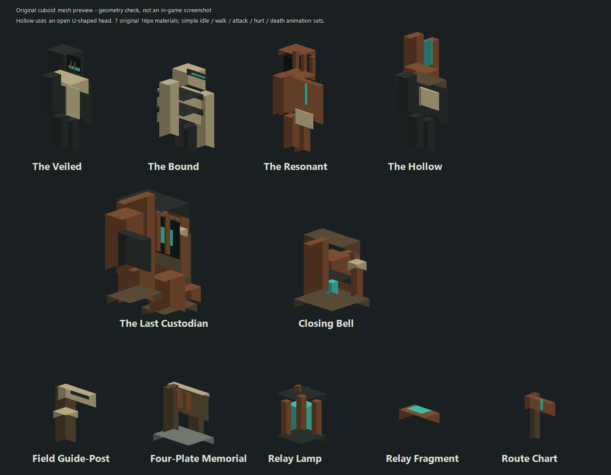
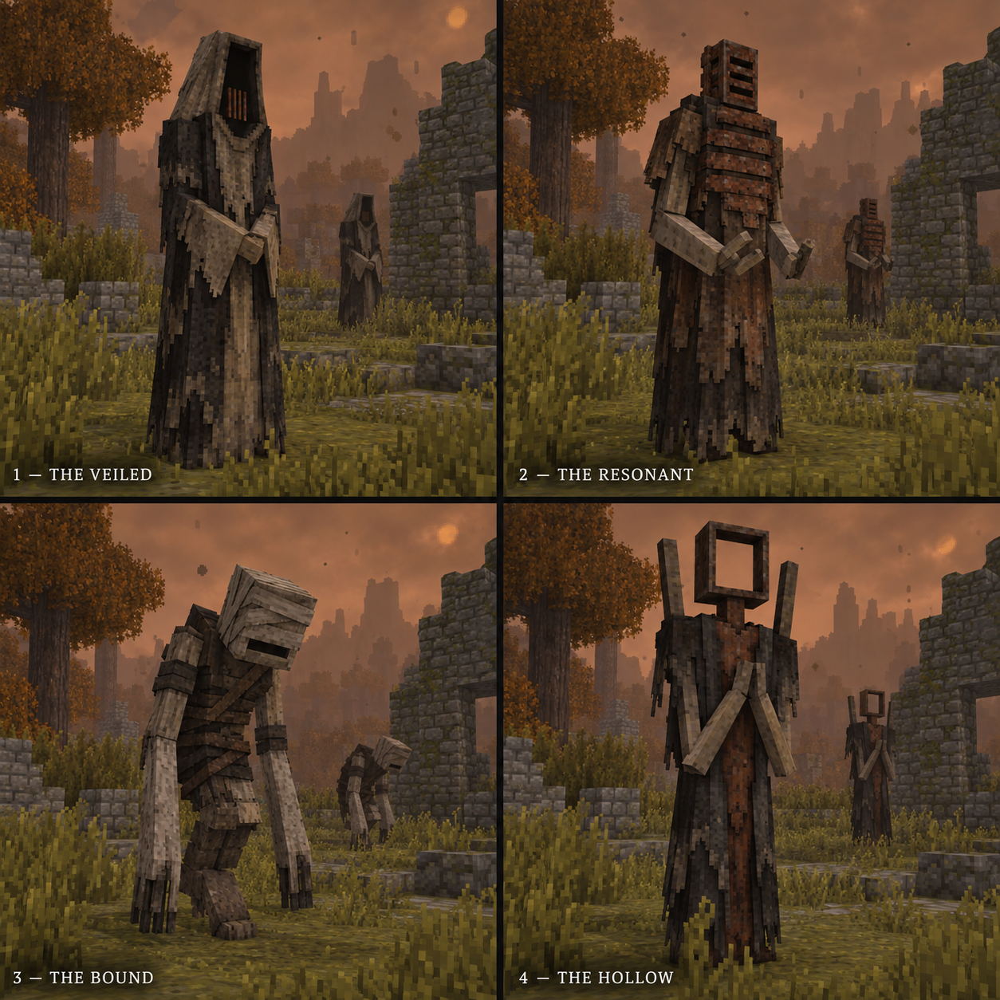
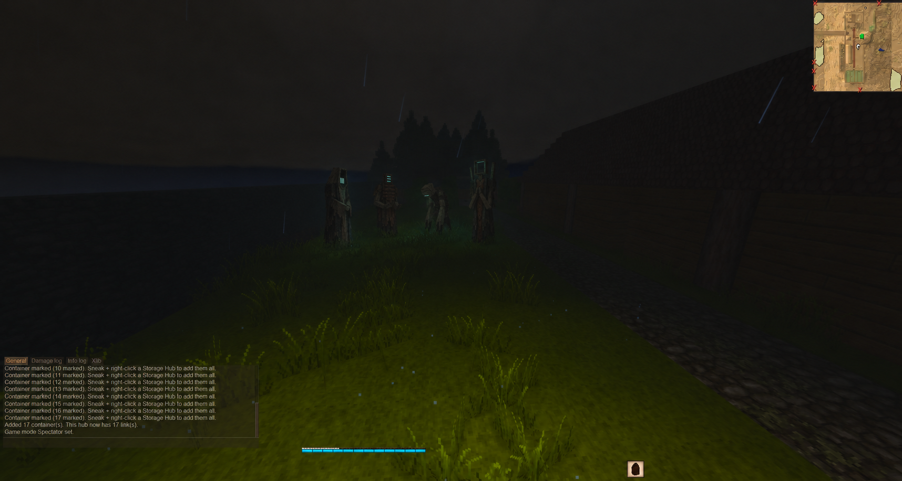
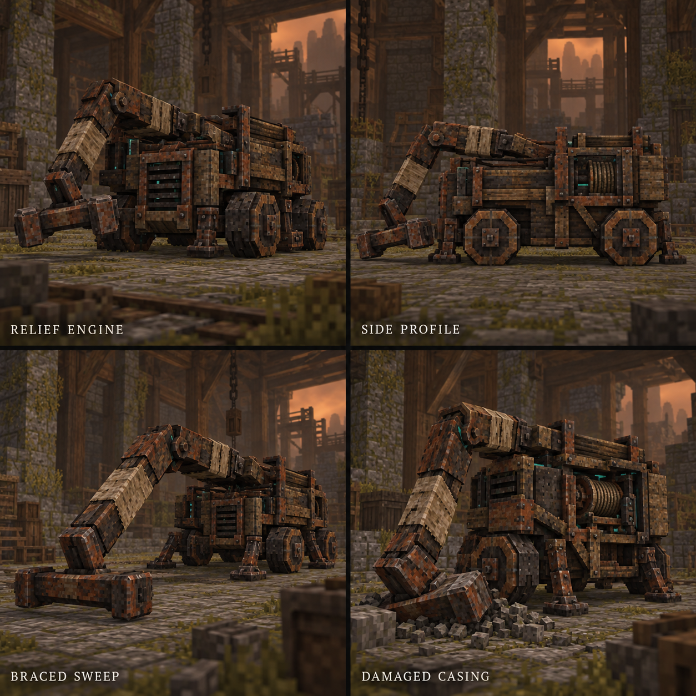
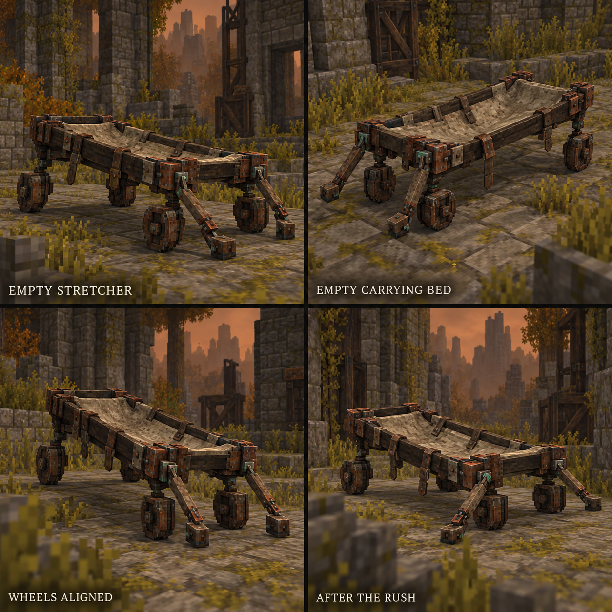
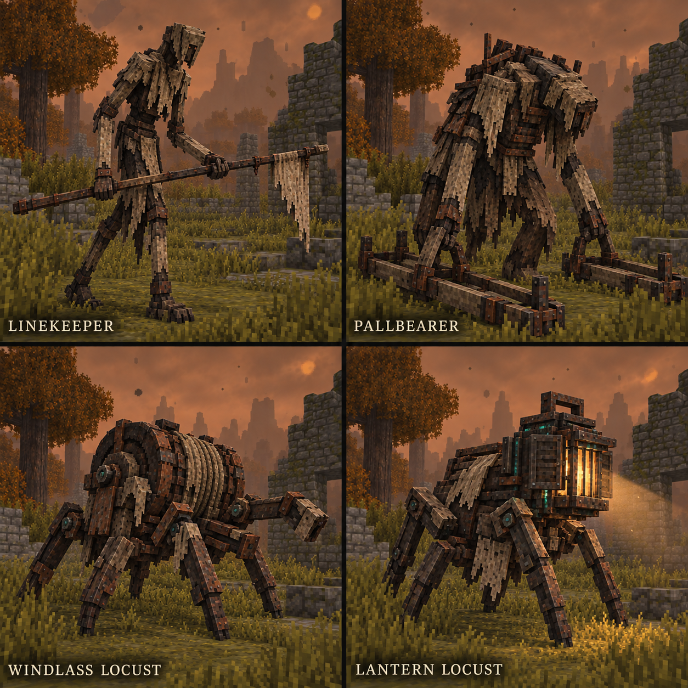

# Visual references

## Runtime assets — development alpha

The development pass now includes original cuboid shapes and seven pixel-material textures under `assets/procession`, with simple idle/walk/attack/hurt/death animation sets. Regenerate them with `tools/content/Generate-Content.ps1` and render the geometry preview with `tools/content/Preview-Content.ps1`. These assets are separate from the AI concept illustrations below.

This preview checks geometry, materials and silhouettes; it is **not an in-game screenshot or proof of client animation/rendering**. The Hollow uses the revised open U-shaped head. The current Custodian is a simpler upright guardian; other DLC creature concepts are not yet runtime assets. See [implementation](IMPLEMENTATION.md) and [playtest gates](PLAYTEST.md).

## Earlier concept illustrations

These are **AI-generated concept mockups**, not screenshots of an implemented mod, meshes, textures, or game-ready assets. Created with the built-in image generation tool during design discussion.

## Four design directions

1. **The Veiled:** tall hooded figure, faceless recess, barred mouth.
2. **The Resonant:** rusted chest plates and cage-like head.
3. **The Bound:** hunched wrapped figure with long hanging arms.
4. **The Hollow:** empty rectangular head frame in the original image.

Approved direction: use four unique designs based on these references. **Revision:** the bell specialist's head should be an open U-shaped tuning fork (two parallel cuboid prongs joined at the base), not the closed rectangular frame shown here. No updated image of this revision has been generated.

Working specialty assignment proposed in chat: Bound/shivers, Veiled/bowtorns, Resonant/locusts, Hollow/bell. Bell's tuning-fork identity is explicit; the other assignments remain a proposed mapping.

Generation brief: a 2x2 comparison of passive otherworldly chanters rendered like Vintage Story screenshots, with simple cuboid anatomy, pixel textures, weathered flax/charcoal/rusted materials, in a grassy clearing during a rusty temporal storm. No weapons, summoning portals, or cinematic high-poly rendering. The four distinct silhouettes were the core request.

## Dark-world screenshot mockup

Generated edit of a user-supplied dark rainy gameplay screenshot. Four chanters stand in the background near the treeline, with subtle teal/verdigris emissions on face slits and inner edges, while retaining the original setting and HUD. This establishes visibility/glow intent; it does not demonstrate in-engine rendering or gameplay. The head in this mockup also predates the tuning-fork revision.

## DLC mob concepts — 2026-10-29

Generated at the user's request to visualize the new mobs, especially the Relief Engine and Empty Stretcher, in the same style as the chanters. The built-in image generation tool used the original chanter sheet as a style/layout reference. All three new sheets are saved here in the project; the original images are preserved. The [exact prompt set](concepts/dlc-mob-art-prompts.md) records the subjects, poses, materials, labels, and generation method.

These are proposed visual interpretations of [Until They Answer](DLC_CONCEPT.md). They are not game screenshots, production meshes/textures, verified animation frames, or approved final anatomy. Multi-view geometry and joint placement remain approximate; panel labels do not add combat rules. Scattered masonry is environmental dressing, not approval of terrain destruction.

### Relief Engine

Four views/poses: front three-quarter, side profile, braced sweep, and damaged casing. A low timber-and-rusted-iron hauling chassis carries a heavy hinged recovery arm, chunky wheels, short stabilizers, exposed winch parts, linen repairs, and restrained teal seams. It is a separate ruin-machine concept, not a summoned procession finale.

### Empty Stretcher

Four views/poses show the empty carrying bed, small wheels, hinged guide arms, and rolling preparation/recovery. The sagging linen is visibly unoccupied, with loose straps and open space above it. No passenger or identity reveal is implied.

### Defender comparison

Clockwise from upper left: Linekeeper, Pallbearer, Lantern Locust, Windlass Locust. The sheet explores a guide-pole silhouette, broad carrying-rail silhouette, shuttered-light crawler, and drum-backed hauling crawler. Cloth, timber, and metal details connect them visually to the rescue theme; this does not establish historical creature origins or finalize the proposed family anatomy.
